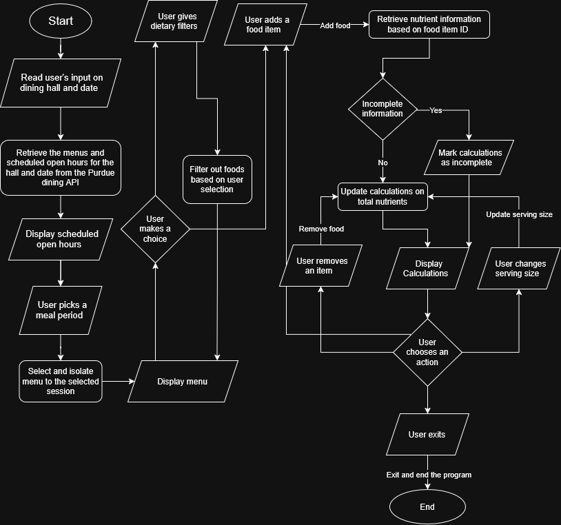

# CS193_Dining_Nutrition_Tracker

A Java terminal program to explore the Purdue dining menus, add food items for a specific meal, and calculate the nutritional totals of them.

## The Problem

Purdue students can view dining menus, but calculating the combined nutrition of several foods with different serving sizes is very tedious and annoying. This project is to hopefully make it easier to find suitable foods and track the nutritional content of a meal you're planning to have.

## Planned MVP

- Select a dining hall, date, and meal period.
- Retrieve menu information from Purdue’s dining API.
- Filter foods using published vegetarian, vegan, and allergen information.
- Add and remove foods from a selected meal.
- Set and update serving quantities.
- Calculate total calories, protein, carbohydrates, and fat.
- Handle invalid input, failed requests, and missing information with clear messages.
- Clearly identify incomplete nutrition totals.

## System Diagram

## Design Documents

- [Eisenhower Matrix](docs/eisenhower-matrix.pdf)
- [System Diagram](docs/system-diagram.png)

## Tech Stack

- **Language:** Java
- **Built-in tools:** `HttpClient` for HTTP requests, `LocalDate` for dates, and `Scanner` for terminal input
- **External library:** Gson for parsing JSON
- **Data source:** [Purdue dining API](https://api.hfs.purdue.edu/menus/v2)
- **Data storage:** Menu items, selected foods, and serving quantities held in memory using Java objects, variables, and arrays. Sample API responses stored in JSON files for development and testing.

## Project Structure

- `src/` — Java source files
- `tests/` — Test code and sample API responses
- `docs/` — Eisenhower Matrix and system diagram

## Setup and Usage

The project is currently in the planning stage and does not yet contain a runnable application. Setup instructions and usage examples will be added as implementation progresses.

## Roadmap

Features planned after the MVP:

- [ ] Compare meal totals against user-entered nutritional goals.
- [ ] Support fractional serving quantities.
- [ ] Recommend meals based on nutritional goals and food preferences.

## Author

Aryan
